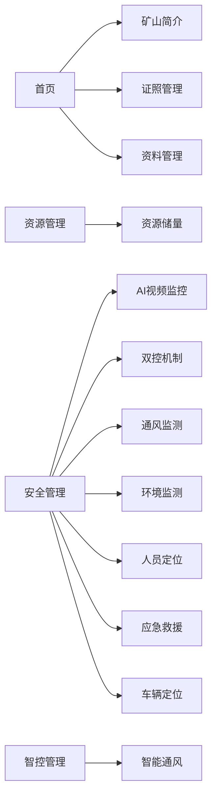

# 自动化产出：动态 UI 组件架构拓扑

> 💡 **说明**：以 `docs/explore_rules.md` 为全局不变骨架，结合 **Post-Click Diff 双图差分** 与 **Component Awareness 组件感知** 动态延申业务页面内部的组件与弹窗拓扑。

## 🌳 纯 Markdown 组件拓扑树

```text
📁 首页
    ├── 📄 矿山简介
    ├── 📄 证照管理
    └── 📄 资料管理
📁 资源管理
    └── 📄 资源储量
📁 安全管理
    ├── 📄 AI视频监控
    ├── 📄 双控机制
    ├── 📄 通风监测
    ├── 📄 环境监测
    ├── 📄 人员定位
    ├── 📄 应急救援
    └── 📄 车辆定位
📁 智控管理
    └── 📄 智能通风
```

## 🗺️ Mermaid 拓扑图 (辅助参考)


