# 自动化产出：动态 UI 组件架构拓扑

> 💡 **说明**：以 `docs/explore_rules.md` 为全局不变骨架，结合 **Post-Click Diff 双图差分** 与 **Component Awareness 组件感知** 动态延申业务页面内部的组件与弹窗拓扑。

## 🌳 纯 Markdown 组件拓扑树

```text
📁 首页
    ├── 📄 矿山简介
    │   ├── 📋 企业简介视频播放器
    │   │   └── 📁 顶部一级菜单【首页】
    │   ├── 📋 资源储量
    │   │   ├── 📁 证实储量数据卡片
    │   │   ├── 📁 可信储量数据卡片
    │   │   ├── 📁 探明资源量数据卡片
    │   │   ├── 📁 控制资源量数据卡片
    │   │   ├── 📁 推断资源量数据卡片
    │   │   └── 📊 矿石品位图表
    │   ├── 📊 矿石品位图表
    │   └── 📁 顶部一级菜单【资源管理】
    ├── 📄 证照管理
    │   ├── 📁 排污许可证主卡片区域
    │   │   └── 🪟 排污许可证弹窗
    │   │       └── 📁 排污许可证主卡片区域
    │   ├── 📁 采矿许可证主卡片区域
    │   │   ├── 证照管理左侧卡片区域
    │   │   │   ├── 📁 采矿许可证主卡片区域
    │   │   │   ├── 📁 左侧菜单中的‘采矿许可证’主卡片区域
    │   │   │   ├── 📁 左侧菜单中的‘爆破作业单位许可证’主卡片区域
    │   │   │   ├── 📁 左侧菜单中的‘安全生产许可证’主卡片区域
    │   │   │   ├── 📁 左侧菜单中的‘企业法人营业执照’主卡片区域
    │   │   │   └── 📁 左侧卡片区域中的‘安全生产许可证’主卡片区域
    │   │   ├── 证照信息右侧详情栏
    │   │   │   ├── 📁 右侧信息栏中的‘有效期’、‘证照编号’、‘发证机关’等字段区域
    │   │   │   ├── 📁 右侧证照信息区域中的‘证照编号’字段
    │   │   │   └── 📁 右侧证照信息区域中的‘发证机关’字段
    │   │   ├── 采矿许可证右侧详情栏
    │   │   │   ├── 📁 右侧详情栏中的‘生产规模’字段区域
    │   │   │   └── 📁 右侧详情栏中的‘矿区面积’字段区域
    │   │   └── 📁 右侧详情栏中的‘生产规模’字段区域
    │   ├── 📁 安全生产许可证主卡片区域
    │   │   ├── 证照管理左侧卡片区域
    │   │   │   ├── 📁 左侧菜单中的‘安全生产许可证’主卡片区域
    │   │   │   ├── 📁 左侧菜单中的‘企业法人营业执照’主卡片区域
    │   │   │   └── 📁 左侧菜单中的‘爆破作业单位许可证’主卡片区域
    │   │   └── 安全生产许可证右侧详情栏
    │   ├── 📋 证照信息
    │   ├── 📋 企业法人营业执照
    │   │   ├── 证照管理左侧卡片区域
    │   │   │   ├── 📁 左侧菜单中的‘企业法人营业执照’主卡片区域
    │   │   │   ├── 📁 左侧菜单中的‘采矿许可证’主卡片区域
    │   │   │   └── 📁 左侧菜单中的‘安全生产许可证’主卡片区域
    │   │   └── 📁 右侧详情栏中的‘证照名称’、‘证照编号’、‘发证机关’等字段区域
    │   ├── 📋 爆破作业单位许可证
    │   │   ├── 证照管理左侧卡片区域
    │   │   │   ├── 📁 左侧菜单中的‘采矿许可证’主卡片区域
    │   │   │   ├── 📁 左侧菜单中的‘爆破作业单位许可证’主卡片区域
    │   │   │   ├── 📁 爆破作业单位许可证主卡片区域
    │   │   │   ├── 📁 左侧菜单中的‘企业法人营业执照’主卡片区域
    │   │   │   └── 📁 左侧菜单中的‘安全生产许可证’主卡片区域
    │   │   ├── 📁 右侧详情栏中的‘有效期’字段区域
    │   │   ├── 📁 右侧详情栏中的‘证照编号’字段区域
    │   │   └── 📁 右侧详情栏中的‘发证机关’字段区域
    │   └── 📁 左侧卡片区域中的‘采矿许可证’主卡片区域
    ├── 📄 资料管理
    │   ├── 📋 企业简介视频播放器
    │   │   └── 入井须知视频播放器
    │   │       └── 🔲 视频播放器右上角的关闭按钮（X）
    │   └── 📋 入井须知视频播放器
    ├── 📁 智控管理一级菜单
    ├── 📄 智能胶带运输
    ├── 📁 顶部一级菜单【资源管理】
    └── 📄 勘探报告
📁 资源管理
    ├── 📄 资源储量
    │   ├── 📋 剩余资源量趋势
    │   ├── 📊 最新核实资源量图表
    │   ├── 📋 底部设备标签栏
    │   │   ├── 🔲 底部标签栏中的【品位】按钮
    │   │   ├── 🔲 底部标签栏中的【地表】按钮
    │   │   └── 🔲 底部标签栏中的【巷道】按钮
    │   ├── 📋 品位
    │   │   ├── 底部设备标签栏
    │   │   │   └── 🔲 底部标签栏中的【地表】按钮
    │   │   ├── 📊 最新核实资源量图表
    │   │   └── 年度资源储量雷达图
    │   ├── 📋 地表
    │   │   ├── 底部设备标签栏
    │   │   ├── 剩余资源量趋势
    │   │   ├── 年度资源储量雷达图
    │   │   ├── 📊 最新核实资源量图表
    │   │   └── 矿石矿物组成
    │   └── 📋 巷道
    │       ├── 底部设备标签栏
    │       ├── 矿石矿物组成
    │       └── 📊 最新核实资源量图表
    └── 📄 勘探报告
        ├── 📋 左侧报告列表
        │   ├── 📋 左侧列表中的‘秦湾矿区采样点描图’报告条目
        │   └── 📋 左侧列表中的‘附表泰湾磷矿2023年储量年报附表’报告条目
        ├── 📋 秦湾矿区采样点描图
        │   └── 📋 左侧报告列表
        │       └── 🪟 “左侧列表中的‘秦湾矿区采样点描图’报告条目”弹窗
        └── 📋 附表泰湾磷矿2023年储量年报附表
            └── 📋 左侧报告列表
                └── 🪟 “左侧列表中的‘附表泰湾磷矿2023年储量年报附表’报告条目”弹窗
📁 生产管理
    ├── 📊 生产统计
    │   └── 📋 运输概况(矿仓出矿)
    ├── 📄 矿仓监测
    ├── 📄 卡车调度
    ├── 📄 能耗监测
    └── 📄 胶带运输监测
📁 设备管理
    ├── 📄 采掘设备
    ├── 📄 运输设备
    └── 📄 特种作业设备
📁 安全管理
    ├── 🗺️ 采场可视化
    ├── 📄 人车防碰撞
    ├── 📄 AI视频监控
    ├── 📄 双控机制
    ├── 📄 通风监测
    ├── 📄 环境监测
    ├── 📄 地压监测
    ├── 📄 人员定位
    ├── 📄 应急救援
    ├── 📄 安全培训
    ├── 📄 人员安全档案
    └── 📄 车辆定位
📁 智控管理
    ├── 📄 智能通风
    │   ├── 📋 980南回风斜井风机
    │   │   └── 近七天风量数据
    │   ├── 📋 1242回风竖井风机
    │   │   ├── 电机详情
    │   │   ├── 近七天风量数据
    │   │   ├── 📋 风机操作记录
    │   │   └── 风机详情
    │   ├── 📋 风机设备切换栏
    │   │   ├── 📁 1242回风竖井风机标签
    │   │   └── 📁 980南回风斜井风机标签
    │   └── 📋 场景总览
    │       └── 底部设备标签栏
    │           └── 📁 1#中央配电室标签
    ├── 📄 智能溜破
    │   ├── 📋 溜井监测
    │   │   ├── 📁 630-1#溜井的实时水位数值显示区域
    │   │   ├── 📁 630-2#溜井的实时水位数值显示区域
    │   │   ├── 📁 730-2#溜井的实时水位数值显示区域
    │   │   ├── 📁 810溜井的实时水位数值显示区域
    │   │   └── 放矿机监测
    │   │       ├── 🔲 630-1#溜井下方的‘停止’按钮
    │   │       └── 🔲 730-2#溜井下方的‘停止’按钮
    │   └── 📋 破碎锤监测
    │       ├── 📁 730_2破碎锤的运行状态指示灯（当前显示为‘运行’）
    │       ├── 📁 730_1破碎锤的运行状态指示灯（当前显示为‘运行’）
    │       ├── 🔲 810破碎锤下方的‘停止’按钮
    │       └── 🔲 730_2破碎锤下方的‘停止’按钮
    ├── 📄 智能破碎锤
    │   ├── 📋 溜井监测
    │   │   └── 破碎锤监测
    │   │       └── 📁 810破碎锤的运行状态指示灯（当前显示为‘运行’）
    │   ├── 📋 破碎锤监测
    │   │   ├── 🔲 810破碎锤下方的‘停止’按钮
    │   │   ├── 🔲 730_2破碎锤下方的‘停止’按钮
    │   │   ├── 🔲 730_1破碎锤下方的‘停止’按钮
    │   │   ├── 📁 810溜破锤的运行状态指示灯（当前显示为‘运行’）
    │   │   ├── 📁 730_1破碎锤的电机电压数值显示区域
    │   │   ├── 730_2破碎锤数据监控卡片
    │   │   │   └── 📁 730_2破碎锤的电机电压数值显示区域
    │   │   ├── 730_1破碎锤数据监控卡片
    │   │   │   └── 📁 730_1破碎锤的液压油位数值显示区域
    │   │   └── 810破碎锤数据监控卡片
    │   │       └── 📁 810破碎锤的电机电压数值显示区域
    │   ├── 📋 730_2破碎锤
    │   │   ├── 其他数据监测
    │   │   │   ├── 📁 730_2破碎锤的液压压力数值显示区域
    │   │   │   ├── 📁 730_2破碎锤的电机电流数值显示区域
    │   │   │   ├── 📁 730_2破碎锤的电机电压数值显示区域（406 V）
    │   │   │   ├── 📁 730_2破碎锤的液压油位数值显示区域（61%）
    │   │   │   ├── 📁 630-1破碎锤的电机电压数值显示区域（397 V）
    │   │   │   ├── 📁 630-2破碎锤的液压压力数值显示区域（142 bar）
    │   │   │   ├── 📁 液压压力数值显示区域（150 bar）
    │   │   │   └── 📁 液压压力 150 bar 数值显示区域
    │   │   ├── 810破碎锤数据监控卡片
    │   │   ├── 视频监控
    │   │   └── 🗺️ 中央三维视图控制区
    │   │       ├── 🔲 默认视角按钮
    │   │       └── 🔲 源区按钮
    │   ├── 📋 730_1破碎锤
    │   │   └── 其他数据监测
    │   │       └── 📁 730_1破碎锤的电机电压数值显示区域（398 V）
    │   └── 📋 630-1破碎锤
    │       └── 其他数据监测
    │           └── 📁 630-1破碎锤的液压压力数值显示区域（118 bar）
    ├── 📄 智能胶带运输
    │   ├── 📋 胶带数据区域
    │   │   ├── 📁 4#平硐胶带标签
    │   │   └── 📁 3#平硐胶带标签
    │   ├── 📋 4#平硐胶带
    │   │   ├── 📊 运输量图表
    │   │   ├── 胶带数据区域
    │   │   │   ├── 📁 5#603石门胶带数据卡片
    │   │   │   └── 📁 3#平硐胶带数据卡片
    │   │   └── 底部胶带标签栏
    │   │       └── 📁 4#平硐胶带标签
    │   ├── 📋 5#603石门胶带
    │   │   ├── 📋 胶带监测预警列表
    │   │   ├── 胶带数据区域
    │   │   │   └── 📁 5#603石门胶带标签
    │   │   ├── 📁 智控管理一级菜单
    │   │   └── 底部胶带标签栏
    │   │       └── 📁 5#603石门胶带标签
    │   ├── 📋 3#平硐胶带
    │   │   ├── 胶带数据
    │   │   │   ├── 📁 3#平硐胶带数据卡片
    │   │   │   └── 📁 5#603石门胶带标签
    │   │   ├── 胶带监测预警
    │   │   └── 底部胶带标签栏
    │   │       └── 📁 3#平硐胶带标签
    │   ├── 📋 底部胶带标签栏
    │   │   ├── 📁 3#平硐胶带标签
    │   │   ├── 📁 5#603石门胶带标签
    │   │   └── 📁 5#石门胶带标签
    │   └── 📋 5#石门胶带
    │       ├── 底部胶带标签栏
    │       │   └── 📁 5#石门胶带标签
    │       └── 胶带数据区域
    │           └── 📁 5#石门胶带标签对应的右侧数据卡片区域
    ├── 📄 智能供配电
    │   ├── 📋 节能与计量
    │   │   └── 核心设备与保护
    │   ├── 📋 核心设备与保护
    │   ├── 📋 底部设备标签栏
    │   │   └── 📁 1#中央配电室标签
    │   ├── 📋 1#中央配电室
    │   │   ├── 底部设备标签栏
    │   │   │   ├── 📁 1#中央配电室标签
    │   │   │   └── 📁 2#中央配电室标签
    │   │   ├── 智能供配电模块右侧业务面板
    │   │   │   ├── 📁 右侧2D业务面板中的设备状态与参数监控卡片
    │   │   │   └── 📁 右侧2D业务面板中的‘核心设备与保护’区域
    │   │   ├── 核心设备与保护
    │   │   └── 右侧2D业务面板
    │   │       └── 📁 核心设备与保护区域中的‘变压器选型’字段（包含SCB-13干式/S11-M油浸和KSG11矿用）
    │   └── 📋 2#中央配电室
    │       ├── 智能供配电模块右侧业务面板
    │       │   ├── 📁 右侧2D业务面板中的‘核心设备与保护’区域
    │       │   ├── 📁 右侧2D业务面板中设备运行参数与状态信息
    │       │   ├── 📁 右侧2D业务面板中的设备运行参数与状态信息区域
    │       │   ├── 📁 右侧2D业务面板中‘核心设备与保护’区域的变压器选型字段及设备运行参数信息
    │       │   └── 📁 右侧2D业务面板中的设备状态与参数监控卡片
    │       ├── 底部设备标签栏
    │       │   └── 📁 2#中央配电室标签
    │       ├── 核心设备与保护
    │       └── 右侧2D业务面板
    └── 📄 智能巡检
        ├── 📋 预警记录
        │   └── 机器人监控视窗
        │       └── 📁 红外热成像区域
        ├── 📋 机器人监控视窗
        │   ├── 对某检查结果
        │   │   └── 🔲 ‘采集信息’字段旁边的展开图标（疑似展开按钮）
        │   ├── 📁 红外热成像区域
        │   ├── 对象检查结果
        │   │   └── 📁 采集信息字段
        │   └── 🪟 高清相机弹窗
        └── 📋 高清相机
            ├── 📁 WH-B-988 备用电源系统装置面板上的‘0.灭’指示灯
            ├── 📁 WH-B-988 备用电源系统装置面板上的‘1.灭’指示灯
            ├── 📁 WH-B-988 备用电源系统装置面板上的‘2.灭’指示灯
            ├── 📁 WH-B-988 备用电源系统装置面板上的‘5.灭’指示灯
            ├── 🔲 WH-B-988 备用电源系统装置面板上的‘启动’按钮
            ├── 📁 WH-B-988 备用电源系统装置面板上的‘3.灭’指示灯
            ├── 📁 WH-B-988 备用电源系统装置面板上的‘4.灭’指示灯
            └── 📁 WH-B-988 备用电源系统装置面板上的设备型号标签（WH-B-988）
📁 资料管理
    ├── 📄 入井须知视频播放器
    │   └── 📁 顶部一级菜单【首页】
    └── 📄 勘探报告
        └── 📋 秦湾矿区采样点描图
            └── PDF预览窗口工具栏
                ├── 🔲 PDF预览窗口顶部的‘+’缩放按钮
                ├── 🔲 PDF预览窗口顶部的‘-’缩放按钮
                ├── 🔲 PDF预览窗口顶部的‘下一页’按钮
                └── 🔲 PDF预览窗口顶部的‘上一页’按钮
```

## 🗺️ Mermaid 拓扑图 (辅助参考)

```mermaid
graph LR
    N0["首页"] --> N1["矿山简介"]
        N1["矿山简介"] --> N2["企业简介视频播放器"]
            N2["企业简介视频播放器"] --> N3["📁 顶部一级菜单【首页】"]
        N1["矿山简介"] --> N4["资源储量"]
            N4["资源储量"] --> N5["📁 证实储量数据卡片"]
            N4["资源储量"] --> N6["📁 可信储量数据卡片"]
            N4["资源储量"] --> N7["📁 探明资源量数据卡片"]
            N4["资源储量"] --> N8["📁 控制资源量数据卡片"]
            N4["资源储量"] --> N9["📁 推断资源量数据卡片"]
            N4["资源储量"] --> N10["矿石品位图表"]
        N1["矿山简介"] --> N10["矿石品位图表"]
        N1["矿山简介"] --> N11["📁 顶部一级菜单【资源管理】"]
    N0["首页"] --> N12["证照管理"]
        N12["证照管理"] --> N13["📁 排污许可证主卡片区域"]
            N13["📁 排污许可证主卡片区域"] --> N14["排污许可证弹窗"]
                N14["排污许可证弹窗"] --> N13["📁 排污许可证主卡片区域"]
        N12["证照管理"] --> N15["📁 采矿许可证主卡片区域"]
            N15["📁 采矿许可证主卡片区域"] --> N16["证照管理左侧卡片区域"]
                N16["证照管理左侧卡片区域"] --> N15["📁 采矿许可证主卡片区域"]
                N16["证照管理左侧卡片区域"] --> N17["📁 左侧菜单中的‘采矿许可证’主卡片区域"]
                N16["证照管理左侧卡片区域"] --> N18["📁 左侧菜单中的‘爆破作业单位许可证’主卡片区域"]
                N16["证照管理左侧卡片区域"] --> N19["📁 左侧菜单中的‘安全生产许可证’主卡片区域"]
                N16["证照管理左侧卡片区域"] --> N20["📁 左侧菜单中的‘企业法人营业执照’主卡片区域"]
                N16["证照管理左侧卡片区域"] --> N21["📁 左侧卡片区域中的‘安全生产许可证’主卡片区域"]
            N15["📁 采矿许可证主卡片区域"] --> N22["证照信息右侧详情栏"]
                N22["证照信息右侧详情栏"] --> N23["📁 右侧信息栏中的‘有效期’、‘证照编号’、‘发证机关’等字段区域"]
                N22["证照信息右侧详情栏"] --> N24["📁 右侧证照信息区域中的‘证照编号’字段"]
                N22["证照信息右侧详情栏"] --> N25["📁 右侧证照信息区域中的‘发证机关’字段"]
            N15["📁 采矿许可证主卡片区域"] --> N26["采矿许可证右侧详情栏"]
                N26["采矿许可证右侧详情栏"] --> N27["📁 右侧详情栏中的‘生产规模’字段区域"]
                N26["采矿许可证右侧详情栏"] --> N28["📁 右侧详情栏中的‘矿区面积’字段区域"]
            N15["📁 采矿许可证主卡片区域"] --> N27["📁 右侧详情栏中的‘生产规模’字段区域"]
        N12["证照管理"] --> N29["📁 安全生产许可证主卡片区域"]
            N29["📁 安全生产许可证主卡片区域"] --> N16["证照管理左侧卡片区域"]
                N16["证照管理左侧卡片区域"] --> N19["📁 左侧菜单中的‘安全生产许可证’主卡片区域"]
                N16["证照管理左侧卡片区域"] --> N20["📁 左侧菜单中的‘企业法人营业执照’主卡片区域"]
                N16["证照管理左侧卡片区域"] --> N18["📁 左侧菜单中的‘爆破作业单位许可证’主卡片区域"]
            N29["📁 安全生产许可证主卡片区域"] --> N30["安全生产许可证右侧详情栏"]
        N12["证照管理"] --> N31["证照信息"]
        N12["证照管理"] --> N32["企业法人营业执照"]
            N32["企业法人营业执照"] --> N16["证照管理左侧卡片区域"]
                N16["证照管理左侧卡片区域"] --> N20["📁 左侧菜单中的‘企业法人营业执照’主卡片区域"]
                N16["证照管理左侧卡片区域"] --> N17["📁 左侧菜单中的‘采矿许可证’主卡片区域"]
                N16["证照管理左侧卡片区域"] --> N19["📁 左侧菜单中的‘安全生产许可证’主卡片区域"]
            N32["企业法人营业执照"] --> N33["📁 右侧详情栏中的‘证照名称’、‘证照编号’、‘发证机关’等字段区域"]
        N12["证照管理"] --> N34["爆破作业单位许可证"]
            N34["爆破作业单位许可证"] --> N16["证照管理左侧卡片区域"]
                N16["证照管理左侧卡片区域"] --> N17["📁 左侧菜单中的‘采矿许可证’主卡片区域"]
                N16["证照管理左侧卡片区域"] --> N18["📁 左侧菜单中的‘爆破作业单位许可证’主卡片区域"]
                N16["证照管理左侧卡片区域"] --> N35["📁 爆破作业单位许可证主卡片区域"]
                N16["证照管理左侧卡片区域"] --> N20["📁 左侧菜单中的‘企业法人营业执照’主卡片区域"]
                N16["证照管理左侧卡片区域"] --> N19["📁 左侧菜单中的‘安全生产许可证’主卡片区域"]
            N34["爆破作业单位许可证"] --> N36["📁 右侧详情栏中的‘有效期’字段区域"]
            N34["爆破作业单位许可证"] --> N37["📁 右侧详情栏中的‘证照编号’字段区域"]
            N34["爆破作业单位许可证"] --> N38["📁 右侧详情栏中的‘发证机关’字段区域"]
        N12["证照管理"] --> N39["📁 左侧卡片区域中的‘采矿许可证’主卡片区域"]
    N0["首页"] --> N40["资料管理"]
        N40["资料管理"] --> N2["企业简介视频播放器"]
            N2["企业简介视频播放器"] --> N41["入井须知视频播放器"]
                N41["入井须知视频播放器"] --> N42["🔲 视频播放器右上角的关闭按钮（X）"]
        N40["资料管理"] --> N41["入井须知视频播放器"]
    N0["首页"] --> N43["📁 智控管理一级菜单"]
    N0["首页"] --> N44["智能胶带运输"]
    N0["首页"] --> N11["📁 顶部一级菜单【资源管理】"]
    N0["首页"] --> N45["勘探报告"]
    N46["资源管理"] --> N4["资源储量"]
        N4["资源储量"] --> N47["剩余资源量趋势"]
        N4["资源储量"] --> N48["最新核实资源量图表"]
        N4["资源储量"] --> N49["底部设备标签栏"]
            N49["底部设备标签栏"] --> N50["🔲 底部标签栏中的【品位】按钮"]
            N49["底部设备标签栏"] --> N51["🔲 底部标签栏中的【地表】按钮"]
            N49["底部设备标签栏"] --> N52["🔲 底部标签栏中的【巷道】按钮"]
        N4["资源储量"] --> N53["品位"]
            N53["品位"] --> N49["底部设备标签栏"]
                N49["底部设备标签栏"] --> N51["🔲 底部标签栏中的【地表】按钮"]
            N53["品位"] --> N48["最新核实资源量图表"]
            N53["品位"] --> N54["年度资源储量雷达图"]
        N4["资源储量"] --> N55["地表"]
            N55["地表"] --> N49["底部设备标签栏"]
            N55["地表"] --> N47["剩余资源量趋势"]
            N55["地表"] --> N54["年度资源储量雷达图"]
            N55["地表"] --> N48["最新核实资源量图表"]
            N55["地表"] --> N56["矿石矿物组成"]
        N4["资源储量"] --> N57["巷道"]
            N57["巷道"] --> N49["底部设备标签栏"]
            N57["巷道"] --> N56["矿石矿物组成"]
            N57["巷道"] --> N48["最新核实资源量图表"]
    N46["资源管理"] --> N45["勘探报告"]
        N45["勘探报告"] --> N58["左侧报告列表"]
            N58["左侧报告列表"] --> N59["📋 左侧列表中的‘秦湾矿区采样点描图’报告条目"]
            N58["左侧报告列表"] --> N60["📋 左侧列表中的‘附表泰湾磷矿2023年储量年报附表’报告条目"]
        N45["勘探报告"] --> N61["秦湾矿区采样点描图"]
            N61["秦湾矿区采样点描图"] --> N58["左侧报告列表"]
                N58["左侧报告列表"] --> N62["“左侧列表中的‘秦湾矿区采样点描图’报告条目”弹窗"]
        N45["勘探报告"] --> N63["附表泰湾磷矿2023年储量年报附表"]
            N63["附表泰湾磷矿2023年储量年报附表"] --> N58["左侧报告列表"]
                N58["左侧报告列表"] --> N64["“左侧列表中的‘附表泰湾磷矿2023年储量年报附表’报告条目”弹窗"]
    N65["生产管理"] --> N66["生产统计"]
        N66["生产统计"] --> N67["运输概况（矿仓出矿）"]
    N65["生产管理"] --> N68["矿仓监测"]
    N65["生产管理"] --> N69["卡车调度"]
    N65["生产管理"] --> N70["能耗监测"]
    N65["生产管理"] --> N71["胶带运输监测"]
    N72["设备管理"] --> N73["采掘设备"]
    N72["设备管理"] --> N74["运输设备"]
    N72["设备管理"] --> N75["特种作业设备"]
    N76["安全管理"] --> N77["采场可视化"]
    N76["安全管理"] --> N78["人车防碰撞"]
    N76["安全管理"] --> N79["AI视频监控"]
    N76["安全管理"] --> N80["双控机制"]
    N76["安全管理"] --> N81["通风监测"]
    N76["安全管理"] --> N82["环境监测"]
    N76["安全管理"] --> N83["地压监测"]
    N76["安全管理"] --> N84["人员定位"]
    N76["安全管理"] --> N85["应急救援"]
    N76["安全管理"] --> N86["安全培训"]
    N76["安全管理"] --> N87["人员安全档案"]
    N76["安全管理"] --> N88["车辆定位"]
    N89["智控管理"] --> N90["智能通风"]
        N90["智能通风"] --> N91["980南回风斜井风机"]
            N91["980南回风斜井风机"] --> N92["近七天风量数据"]
        N90["智能通风"] --> N93["1242回风竖井风机"]
            N93["1242回风竖井风机"] --> N94["电机详情"]
            N93["1242回风竖井风机"] --> N92["近七天风量数据"]
            N93["1242回风竖井风机"] --> N95["风机操作记录"]
            N93["1242回风竖井风机"] --> N96["风机详情"]
        N90["智能通风"] --> N97["风机设备切换栏"]
            N97["风机设备切换栏"] --> N98["📁 1242回风竖井风机标签"]
            N97["风机设备切换栏"] --> N99["📁 980南回风斜井风机标签"]
        N90["智能通风"] --> N100["场景总览"]
            N100["场景总览"] --> N49["底部设备标签栏"]
                N49["底部设备标签栏"] --> N101["📁 1#中央配电室标签"]
    N89["智控管理"] --> N102["智能溜破"]
        N102["智能溜破"] --> N103["溜井监测"]
            N103["溜井监测"] --> N104["📁 630-1#溜井的实时水位数值显示区域"]
            N103["溜井监测"] --> N105["📁 630-2#溜井的实时水位数值显示区域"]
            N103["溜井监测"] --> N106["📁 730-2#溜井的实时水位数值显示区域"]
            N103["溜井监测"] --> N107["📁 810溜井的实时水位数值显示区域"]
            N103["溜井监测"] --> N108["放矿机监测"]
                N108["放矿机监测"] --> N109["🔲 630-1#溜井下方的‘停止’按钮"]
                N108["放矿机监测"] --> N110["🔲 730-2#溜井下方的‘停止’按钮"]
        N102["智能溜破"] --> N111["破碎锤监测"]
            N111["破碎锤监测"] --> N112["📁 730_2破碎锤的运行状态指示灯（当前显示为‘运行’）"]
            N111["破碎锤监测"] --> N113["📁 730_1破碎锤的运行状态指示灯（当前显示为‘运行’）"]
            N111["破碎锤监测"] --> N114["🔲 810破碎锤下方的‘停止’按钮"]
            N111["破碎锤监测"] --> N115["🔲 730_2破碎锤下方的‘停止’按钮"]
    N89["智控管理"] --> N116["智能破碎锤"]
        N116["智能破碎锤"] --> N103["溜井监测"]
            N103["溜井监测"] --> N111["破碎锤监测"]
                N111["破碎锤监测"] --> N117["📁 810破碎锤的运行状态指示灯（当前显示为‘运行’）"]
        N116["智能破碎锤"] --> N111["破碎锤监测"]
            N111["破碎锤监测"] --> N114["🔲 810破碎锤下方的‘停止’按钮"]
            N111["破碎锤监测"] --> N115["🔲 730_2破碎锤下方的‘停止’按钮"]
            N111["破碎锤监测"] --> N118["🔲 730_1破碎锤下方的‘停止’按钮"]
            N111["破碎锤监测"] --> N119["📁 810溜破锤的运行状态指示灯（当前显示为‘运行’）"]
            N111["破碎锤监测"] --> N120["📁 730_1破碎锤的电机电压数值显示区域"]
            N111["破碎锤监测"] --> N121["730_2破碎锤数据监控卡片"]
                N121["730_2破碎锤数据监控卡片"] --> N122["📁 730_2破碎锤的电机电压数值显示区域"]
            N111["破碎锤监测"] --> N123["730_1破碎锤数据监控卡片"]
                N123["730_1破碎锤数据监控卡片"] --> N124["📁 730_1破碎锤的液压油位数值显示区域"]
            N111["破碎锤监测"] --> N125["810破碎锤数据监控卡片"]
                N125["810破碎锤数据监控卡片"] --> N126["📁 810破碎锤的电机电压数值显示区域"]
        N116["智能破碎锤"] --> N127["730_2破碎锤"]
            N127["730_2破碎锤"] --> N128["其他数据监测"]
                N128["其他数据监测"] --> N129["📁 730_2破碎锤的液压压力数值显示区域"]
                N128["其他数据监测"] --> N130["📁 730_2破碎锤的电机电流数值显示区域"]
                N128["其他数据监测"] --> N131["📁 730_2破碎锤的电机电压数值显示区域（406 V）"]
                N128["其他数据监测"] --> N132["📁 730_2破碎锤的液压油位数值显示区域（61%）"]
                N128["其他数据监测"] --> N133["📁 630-1破碎锤的电机电压数值显示区域（397 V）"]
                N128["其他数据监测"] --> N134["📁 630-2破碎锤的液压压力数值显示区域（142 bar）"]
                N128["其他数据监测"] --> N135["📁 液压压力数值显示区域（150 bar）"]
                N128["其他数据监测"] --> N136["📁 液压压力 150 bar 数值显示区域"]
            N127["730_2破碎锤"] --> N125["810破碎锤数据监控卡片"]
            N127["730_2破碎锤"] --> N137["视频监控"]
            N127["730_2破碎锤"] --> N138["中央三维视图控制区"]
                N138["中央三维视图控制区"] --> N139["🔲 默认视角按钮"]
                N138["中央三维视图控制区"] --> N140["🔲 源区按钮"]
        N116["智能破碎锤"] --> N141["730_1破碎锤"]
            N141["730_1破碎锤"] --> N128["其他数据监测"]
                N128["其他数据监测"] --> N142["📁 730_1破碎锤的电机电压数值显示区域（398 V）"]
        N116["智能破碎锤"] --> N143["630-1破碎锤"]
            N143["630-1破碎锤"] --> N128["其他数据监测"]
                N128["其他数据监测"] --> N144["📁 630-1破碎锤的液压压力数值显示区域（118 bar）"]
    N89["智控管理"] --> N44["智能胶带运输"]
        N44["智能胶带运输"] --> N145["胶带数据区域"]
            N145["胶带数据区域"] --> N146["📁 4#平硐胶带标签"]
            N145["胶带数据区域"] --> N147["📁 3#平硐胶带标签"]
        N44["智能胶带运输"] --> N148["4#平硐胶带"]
            N148["4#平硐胶带"] --> N149["运输量图表"]
            N148["4#平硐胶带"] --> N145["胶带数据区域"]
                N145["胶带数据区域"] --> N150["📁 5#603石门胶带数据卡片"]
                N145["胶带数据区域"] --> N151["📁 3#平硐胶带数据卡片"]
            N148["4#平硐胶带"] --> N152["底部胶带标签栏"]
                N152["底部胶带标签栏"] --> N146["📁 4#平硐胶带标签"]
        N44["智能胶带运输"] --> N153["5#603石门胶带"]
            N153["5#603石门胶带"] --> N154["胶带监测预警列表"]
            N153["5#603石门胶带"] --> N145["胶带数据区域"]
                N145["胶带数据区域"] --> N155["📁 5#603石门胶带标签"]
            N153["5#603石门胶带"] --> N43["📁 智控管理一级菜单"]
            N153["5#603石门胶带"] --> N152["底部胶带标签栏"]
                N152["底部胶带标签栏"] --> N155["📁 5#603石门胶带标签"]
        N44["智能胶带运输"] --> N156["3#平硐胶带"]
            N156["3#平硐胶带"] --> N157["胶带数据"]
                N157["胶带数据"] --> N151["📁 3#平硐胶带数据卡片"]
                N157["胶带数据"] --> N155["📁 5#603石门胶带标签"]
            N156["3#平硐胶带"] --> N158["胶带监测预警"]
            N156["3#平硐胶带"] --> N152["底部胶带标签栏"]
                N152["底部胶带标签栏"] --> N147["📁 3#平硐胶带标签"]
        N44["智能胶带运输"] --> N152["底部胶带标签栏"]
            N152["底部胶带标签栏"] --> N147["📁 3#平硐胶带标签"]
            N152["底部胶带标签栏"] --> N155["📁 5#603石门胶带标签"]
            N152["底部胶带标签栏"] --> N159["📁 5#石门胶带标签"]
        N44["智能胶带运输"] --> N160["5#石门胶带"]
            N160["5#石门胶带"] --> N152["底部胶带标签栏"]
                N152["底部胶带标签栏"] --> N159["📁 5#石门胶带标签"]
            N160["5#石门胶带"] --> N145["胶带数据区域"]
                N145["胶带数据区域"] --> N161["📁 5#石门胶带标签对应的右侧数据卡片区域"]
    N89["智控管理"] --> N162["智能供配电"]
        N162["智能供配电"] --> N163["节能与计量"]
            N163["节能与计量"] --> N164["核心设备与保护"]
        N162["智能供配电"] --> N164["核心设备与保护"]
        N162["智能供配电"] --> N49["底部设备标签栏"]
            N49["底部设备标签栏"] --> N101["📁 1#中央配电室标签"]
        N162["智能供配电"] --> N165["1#中央配电室"]
            N165["1#中央配电室"] --> N49["底部设备标签栏"]
                N49["底部设备标签栏"] --> N101["📁 1#中央配电室标签"]
                N49["底部设备标签栏"] --> N166["📁 2#中央配电室标签"]
            N165["1#中央配电室"] --> N167["智能供配电模块右侧业务面板"]
                N167["智能供配电模块右侧业务面板"] --> N168["📁 右侧2D业务面板中的设备状态与参数监控卡片"]
                N167["智能供配电模块右侧业务面板"] --> N169["📁 右侧2D业务面板中的‘核心设备与保护’区域"]
            N165["1#中央配电室"] --> N164["核心设备与保护"]
            N165["1#中央配电室"] --> N170["右侧2D业务面板"]
                N170["右侧2D业务面板"] --> N171["📁 核心设备与保护区域中的‘变压器选型’字段（包含SCB-13干式/S11-M油浸和KSG11矿用）"]
        N162["智能供配电"] --> N172["2#中央配电室"]
            N172["2#中央配电室"] --> N167["智能供配电模块右侧业务面板"]
                N167["智能供配电模块右侧业务面板"] --> N169["📁 右侧2D业务面板中的‘核心设备与保护’区域"]
                N167["智能供配电模块右侧业务面板"] --> N173["📁 右侧2D业务面板中设备运行参数与状态信息"]
                N167["智能供配电模块右侧业务面板"] --> N174["📁 右侧2D业务面板中的设备运行参数与状态信息区域"]
                N167["智能供配电模块右侧业务面板"] --> N175["📁 右侧2D业务面板中‘核心设备与保护’区域的变压器选型字段及设备运行参数信息"]
                N167["智能供配电模块右侧业务面板"] --> N168["📁 右侧2D业务面板中的设备状态与参数监控卡片"]
            N172["2#中央配电室"] --> N49["底部设备标签栏"]
                N49["底部设备标签栏"] --> N166["📁 2#中央配电室标签"]
            N172["2#中央配电室"] --> N164["核心设备与保护"]
            N172["2#中央配电室"] --> N170["右侧2D业务面板"]
    N89["智控管理"] --> N176["智能巡检"]
        N176["智能巡检"] --> N177["预警记录"]
            N177["预警记录"] --> N178["机器人监控视窗"]
                N178["机器人监控视窗"] --> N179["📁 红外热成像区域"]
        N176["智能巡检"] --> N178["机器人监控视窗"]
            N178["机器人监控视窗"] --> N180["对某检查结果"]
                N180["对某检查结果"] --> N181["🔲 ‘采集信息’字段旁边的展开图标（疑似展开按钮）"]
            N178["机器人监控视窗"] --> N179["📁 红外热成像区域"]
            N178["机器人监控视窗"] --> N182["对象检查结果"]
                N182["对象检查结果"] --> N183["📁 采集信息字段"]
            N178["机器人监控视窗"] --> N184["高清相机弹窗"]
        N176["智能巡检"] --> N185["高清相机"]
            N185["高清相机"] --> N186["📁 WH-B-988 备用电源系统装置面板上的‘0.灭’指示灯"]
            N185["高清相机"] --> N187["📁 WH-B-988 备用电源系统装置面板上的‘1.灭’指示灯"]
            N185["高清相机"] --> N188["📁 WH-B-988 备用电源系统装置面板上的‘2.灭’指示灯"]
            N185["高清相机"] --> N189["📁 WH-B-988 备用电源系统装置面板上的‘5.灭’指示灯"]
            N185["高清相机"] --> N190["🔲 WH-B-988 备用电源系统装置面板上的‘启动’按钮"]
            N185["高清相机"] --> N191["📁 WH-B-988 备用电源系统装置面板上的‘3.灭’指示灯"]
            N185["高清相机"] --> N192["📁 WH-B-988 备用电源系统装置面板上的‘4.灭’指示灯"]
            N185["高清相机"] --> N193["📁 WH-B-988 备用电源系统装置面板上的设备型号标签（WH-B-988）"]
    N40["资料管理"] --> N41["入井须知视频播放器"]
        N41["入井须知视频播放器"] --> N3["📁 顶部一级菜单【首页】"]
    N40["资料管理"] --> N45["勘探报告"]
        N45["勘探报告"] --> N61["秦湾矿区采样点描图"]
            N61["秦湾矿区采样点描图"] --> N194["PDF预览窗口工具栏"]
                N194["PDF预览窗口工具栏"] --> N195["🔲 PDF预览窗口顶部的‘+’缩放按钮"]
                N194["PDF预览窗口工具栏"] --> N196["🔲 PDF预览窗口顶部的‘-’缩放按钮"]
                N194["PDF预览窗口工具栏"] --> N197["🔲 PDF预览窗口顶部的‘下一页’按钮"]
                N194["PDF预览窗口工具栏"] --> N198["🔲 PDF预览窗口顶部的‘上一页’按钮"]
```


