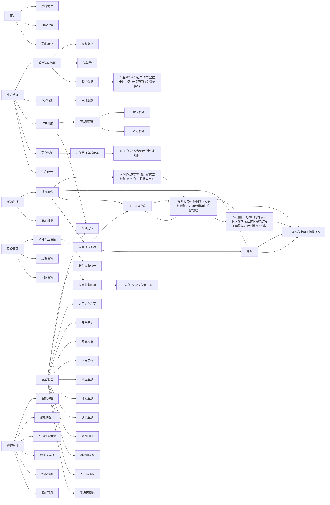

# 自动化产出：动态 UI 组件架构拓扑

> 💡 **说明**：以 `docs/explore_rules.md` 为全局不变骨架，结合 **Post-Click Diff 双图差分** 与 **Component Awareness 组件感知** 动态延申业务页面内部的组件与弹窗拓扑。

## 🌳 纯 Markdown 组件拓扑树

```text
📁 首页
    ├── 📄 矿山简介
    ├── 📄 证照管理
    └── 📄 资料管理
📁 资源管理
    ├── 📄 资源储量
    └── 📄 勘探报告
        ├── 📋 左侧报告列表
        │   ├── 🪟 弹窗
        │   │   └── 🪟 弹窗右上角关闭按钮❌
        │   └── 🪟 PDF预览弹窗
        │       └── 🪟 “左侧报告列表中的‘附表寨湾磷矿2023年储量年报附表’”弹窗
        │           └── 🪟 “左侧报告列表中的‘神农架林区莲花-武山矿区寨湾矿段Ph1矿层柱状对比图’”弹窗
        │               └── 🪟 弹窗右上角关闭按钮❌
        ├── 🪟 PDF预览弹窗
        │   └── 🪟 “左侧报告列表中的‘附表寨湾磷矿2023年储量年报附表’”弹窗
        │       └── 🪟 弹窗右上角关闭按钮❌
        ├── 🪟 弹窗
        │   └── 🪟 弹窗右上角关闭按钮❌
        └── 📋 神农架林区莲花-武山矿区寨湾矿段Ph1矿层柱状对比图
            └── 🪟 “左侧报告列表中的‘附表寨湾磷矿2023年储量年报附表’”弹窗
                └── 🪟 “左侧报告列表中的‘神农架林区莲花-武山矿区寨湾矿段Ph1矿层柱状对比图’”弹窗
📁 生产管理
    ├── 📊 生产统计
    ├── 📄 矿仓监测
    │   └── 📋 右侧数据分析面板
    │       └── 📊 右侧‘出入仓统计分析’折线图
    ├── 📄 卡车调度
    │   ├── 📋 车辆定位
    │   └── 📋 顶部搜索栏
    │       ├── 🔲 查询按钮
    │       └── 🔲 重置按钮
    ├── 📄 能耗监测
    │   └── 📋 电耗监测
    └── 📄 胶带运输监测
        ├── 📋 胶带数据
        │   └── 📁 左侧‘5#603石门胶带’监控卡片中的‘皮带运行速度’数值区域
        ├── 📋 运输量
        └── 📋 视频监控
📁 设备管理
    ├── 📄 采掘设备
    ├── 📄 运输设备
    └── 📄 特种作业设备
        └── 📊 特种设备统计
📁 安全管理
    ├── 🗺️ 采场可视化
    ├── 📄 人车防碰撞
    ├── 📄 AI视频监控
    ├── 📄 双控机制
    ├── 📄 通风监测
    ├── 📄 环境监测
    ├── 📄 地压监测
    ├── 📄 人员定位
    ├── 📄 应急救援
    ├── 📄 安全培训
    ├── 📄 人员安全档案
    ├── 📄 车辆定位
    └── 📄 左侧业务面板
        └── 📁 左侧‘人员分布’环形图
📁 智控管理
    ├── 📄 智能通风
    ├── 📄 智能溜破
    ├── 📄 智能破碎锤
    ├── 📄 智能胶带运输
    ├── 📄 智能供配电
    └── 📄 智能巡检
```

## 🗺️ Mermaid 拓扑图 (辅助参考)


