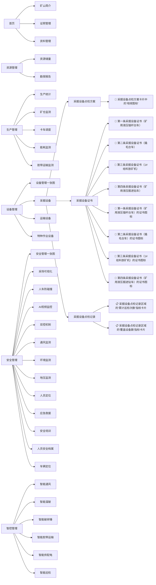

# 自动化产出：动态 UI 组件架构拓扑

> 💡 **说明**：以 `docs/explore_rules.md` 为全局不变骨架，结合 **Post-Click Diff 双图差分** 与 **Component Awareness 组件感知** 动态延申业务页面内部的组件与弹窗拓扑。

## 🌳 纯 Markdown 组件拓扑树

```text
📁 首页
    ├── 📄 矿山简介
    ├── 📄 证照管理
    └── 📄 资料管理
📁 资源管理
    ├── 📄 资源储量
    └── 📄 勘探报告
📁 生产管理
    ├── 📊 生产统计
    ├── 📄 矿仓监测
    ├── 📄 卡车调度
    ├── 📄 能耗监测
    └── 📄 胶带运输监测
📁 设备管理
    ├── 📄 设备管理一张图
    ├── 📄 采掘设备
    │   ├── 📋 采掘设备点检方案
    │   │   └── 📁 采掘设备点检方案卡片中的‘地球图标’
    │   ├── 📋 采掘设备证书
    │   │   ├── 📁 第一条采掘设备证书（矿用液压锚杆台车）
    │   │   ├── 📁 第二条采掘设备证书（撬毛台车）
    │   │   ├── 📁 第三条采掘设备证书（1#给料放矿机）
    │   │   ├── 📁 第四条采掘设备证书（矿用液压掘进钻车）
    │   │   ├── 📁 第一条采掘设备证书（矿用液压锚杆台车）的证书图标
    │   │   ├── 📁 第二条采掘设备证书（撬毛台车）的证书图标
    │   │   ├── 📁 第三条采掘设备证书（1#给料放矿机）的证书图标
    │   │   └── 📁 第四条采掘设备证书（矿用液压掘进钻车）的证书图标
    │   └── 📋 采掘设备点检记录
    │       ├── 📋 采掘设备点检记录区域的‘累计巡检次数’指标卡片
    │       └── 📋 采掘设备点检记录区域的‘覆盖设备数’指标卡片
    ├── 📄 运输设备
    └── 📄 特种作业设备
📁 安全管理
    ├── 📄 安全管理一张图
    ├── 🗺️ 采场可视化
    ├── 📄 人车防碰撞
    ├── 📄 AI视频监控
    ├── 📄 双控机制
    ├── 📄 通风监测
    ├── 📄 环境监测
    ├── 📄 地压监测
    ├── 📄 人员定位
    ├── 📄 应急救援
    ├── 📄 安全培训
    ├── 📄 人员安全档案
    └── 📄 车辆定位
📁 智控管理
    ├── 📄 智能通风
    ├── 📄 智能溜破
    ├── 📄 智能破碎锤
    ├── 📄 智能胶带运输
    ├── 📄 智能供配电
    └── 📄 智能巡检
```

## 🗺️ Mermaid 拓扑图 (辅助参考)


