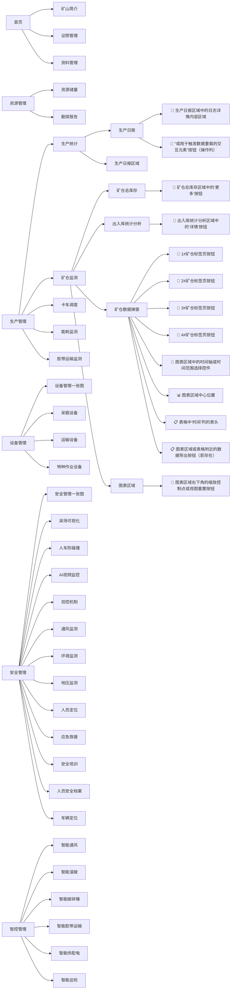

# 自动化产出：动态 UI 组件架构拓扑

> 💡 **说明**：以 `docs/explore_rules.md` 为全局不变骨架，结合 **Post-Click Diff 双图差分** 与 **Component Awareness 组件感知** 动态延申业务页面内部的组件与弹窗拓扑。

## 🌳 纯 Markdown 组件拓扑树

```text
📁 首页
    ├── 📄 矿山简介
    ├── 📄 证照管理
    └── 📄 资料管理
📁 资源管理
    ├── 📄 资源储量
    └── 📄 勘探报告
📁 生产管理
    ├── 📊 生产统计
    │   ├── 📋 生产日报
    │   │   ├── 📁 生产日报区域中的日志详情内容区域
    │   │   └── 🔲 “或用于触发数据重载的交互元素”按钮（操作列）
    │   └── 📋 生产日报区域
    ├── 📄 矿仓监测
    │   ├── 📋 矿仓总库存
    │   │   └── 🔲 矿仓总库存区域中的‘更多’按钮
    │   ├── 📊 出入库统计分析
    │   │   └── 🔲 出入库统计分析区域中的‘详情’按钮
    │   ├── 🪟 矿仓数据弹窗
    │   │   ├── 🔲 1#矿仓标签页按钮
    │   │   ├── 🔲 2#矿仓标签页按钮
    │   │   ├── 🔲 3#矿仓标签页按钮
    │   │   ├── 🔲 4#矿仓标签页按钮
    │   │   ├── 🔽 图表区域中的时间轴或时间范围选择控件
    │   │   ├── 📊 图表区域中心位置
    │   │   ├── 📋 表格中‘时间’列的表头
    │   │   └── 📋 图表区域或表格附近的数据导出按钮（若存在）
    │   └── 📊 图表区域
    │       └── 🔲 图表区域右下角的缩放控制点或视图重置按钮
    ├── 📄 卡车调度
    ├── 📄 能耗监测
    └── 📄 胶带运输监测
📁 设备管理
    ├── 📄 设备管理一张图
    ├── 📄 采掘设备
    ├── 📄 运输设备
    └── 📄 特种作业设备
📁 安全管理
    ├── 📄 安全管理一张图
    ├── 🗺️ 采场可视化
    ├── 📄 人车防碰撞
    ├── 📄 AI视频监控
    ├── 📄 双控机制
    ├── 📄 通风监测
    ├── 📄 环境监测
    ├── 📄 地压监测
    ├── 📄 人员定位
    ├── 📄 应急救援
    ├── 📄 安全培训
    ├── 📄 人员安全档案
    └── 📄 车辆定位
📁 智控管理
    ├── 📄 智能通风
    ├── 📄 智能溜破
    ├── 📄 智能破碎锤
    ├── 📄 智能胶带运输
    ├── 📄 智能供配电
    └── 📄 智能巡检
```

## 🗺️ Mermaid 拓扑图 (辅助参考)


